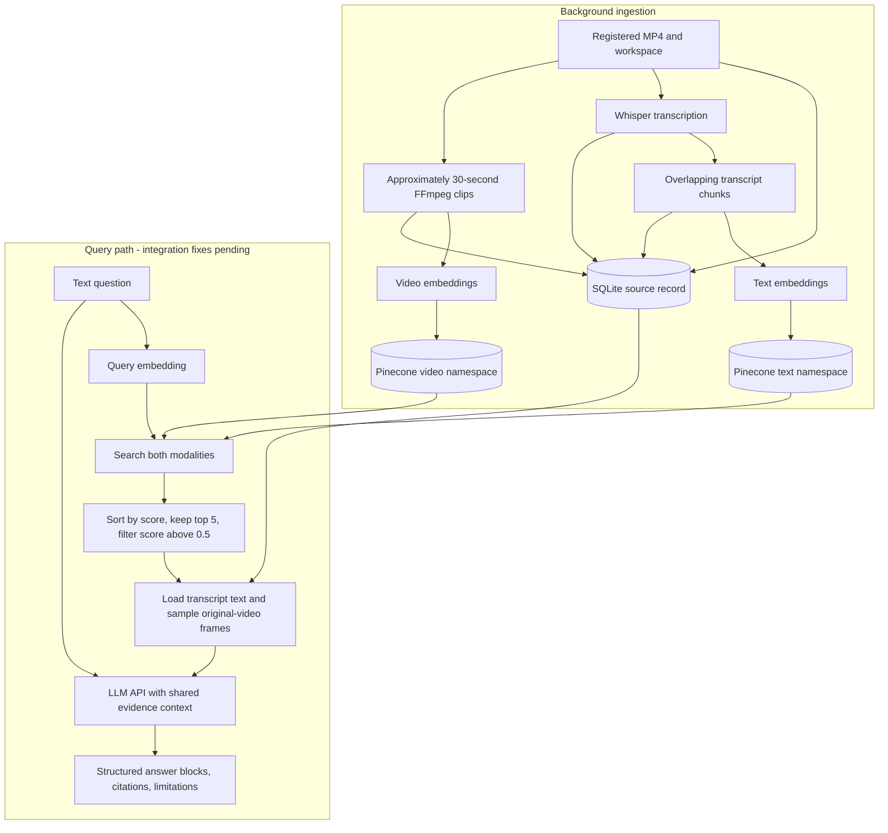

# Video Moment Retrieval

An experimental system for finding moments in videos and answering natural-language questions with timestamped transcript and visual evidence. For example: “Where does the professor explain the difference between machine learning and deep learning?”

The current application entry point is [`src/CLI.py`](src/CLI.py). It manages workspaces, queues MP4 ingestion, stores source metadata and transcripts in SQLite, indexes text and video embeddings in Pinecone, and connects retrieval to structured answers through an LLM API. The query path is implemented but has integration issues described below; it is not yet a verified end-to-end workflow.

## Current scope

The focus is **Approach A: multimodal retrieval and evidence-backed answers**. Existing models perform transcription, embedding, and answer generation without project-specific training. **Option B (the frozen pretrained model / trained adapter approach) is not being pursued for now** and is outside the active plan.

Two retrieval tracks capture different information:

- **Visual:** split a recording into approximately 30-second clips and embed their visual content.
- **Transcript:** transcribe the original recording, clean whitespace, and build overlapping text chunks while retaining segment timestamps.

A text query is embedded and searched against both tracks. Selected transcript text and video frames are supplied together to an answer model, which returns answer blocks and citations. A playback interface, thumbnails, document ingestion, and finer temporal localization remain future work.

The notebooks retain earlier experiments, including local Qwen generation. Their paths, indices, and output formats are separate from the CLI; notebook settings should not be treated as the current CLI configuration.

## High-level architecture



Visual uploads and search both use namespace `videos`. Ingestion opens each clip using its filename from `segments.csv` and assigns a separate source-prefixed vector ID, such as `7_0`. Video encoding checks the file exists and explicitly marks the input as video. Frame extraction samples the original recording at `start + offset`; the CLI supplies a 5-second interval. The broader reliability limitations below still apply.

## Processing and storage

| Component | Current implementation |
| --- | --- |
| Entry point | `python src/CLI.py`, run from the repository root. |
| Device selection | CUDA, then Apple MPS, then CPU. Whisper uses CUDA when available and otherwise CPU. |
| Transcription | Local Whisper `small`; full MP4 input, automatic language detection, segment timestamps, `word_timestamps=False`. |
| Transcript chunks | Whitespace cleanup, recursive splitting of oversized segments, 500-token budget and up to 100 tokens of overlap at unit boundaries. Split pieces retain their enclosing segment times. |
| Embeddings | `google/embeddinggemma-2` through Sentence Transformers; normalized vectors. Pinecone's schema is configured for 768 dimensions. |
| Video embeddings | FFmpeg stream-copy segmentation targets 30 seconds; encoding requests 1 fps, at most 32 frames, timestamps, and 280 soft tokens. Actual clip boundaries come from `segments.csv`. |
| Local persistence | `vrag.db` in the working directory: workspaces, sources, chunks, setup flags, model choices, and API-key status. Raw Whisper output is stored as JSON in the source record. |
| Vector storage | One Pinecone index, `mm-vectors-cli`, with an `embedding` field and cosine metric; text and video use separate namespaces. |
| Credentials | OS keyring under service `vrag-cli`, keyed by provider. The CLI does not load keys from `.env`. |
| Answer generation | OpenAI-style `responses.parse()` with a Pydantic output schema. The CLI passes its selected chat model; the initial in-memory default is `gpt-4o-mini`. |

On startup, a background worker reloads sources in `pending`, `transcribed`, or `text_embeded` states. The ingestion sequence is:

```text
pending -> transcribed -> text_embeded -> completed
```

`text_embeded` is the status spelling used in the code. The worker drains transcription jobs before embedding jobs and unloads one model before loading the other. These are source-level resume points, not a guarantee of safe retries within a partially completed stage.

Temporary video clips and `segments.csv` are created in a `temp/` directory beside the input file and removed after video indexing. The original MP4 stays in place. SQLite and Pinecone retain its absolute path, source ID, and chunk time ranges, so the original file must remain available for visual answers. Transcript text lives in SQLite; Pinecone text records link back through the SQLite chunk ID.

## Retrieval and answers

`PineconeDatabase.query()` requests ten visual hits and ten text hits, combines them, sorts by descending score, and keeps five overall. `RawProcess.semantic_search()` then removes hits with a score at or below `0.5`. There is no modality quota, workspace filter, reranker, or rank fusion. Cross-modality score comparability has not been evaluated.

For text hits, the CLI loads the chunk text from SQLite. For video hits, it attempts to extract JPEG frames from the original source. The frame helper resizes images to at most 1024 pixels on the longest side and encodes them as data URLs. All selected evidence is placed in one user message and answered in one API call; there is no independent per-hit inference stage.

The structured result contains:

- `status`: `answered`, `partial`, or `insufficient_evidence`.
- `answer_blocks`: text and citations, with a source ID, optional start/end seconds, evidence type (`text` or `visual`), and explanation.
- `limitations`: evidence gaps or uncertainty.

The prompt asks for evidence-grounded claims, original-video timestamps, whole transcript-chunk ranges where finer timing is unavailable, and individual sampled-frame citations. These are instructions to the model. Python validates the output shape but does not check citation identity, timestamp bounds, or claim support against the retrieved evidence.

Source IDs sent to the answer model are the source **basenames**, not unique chunk IDs. The terminal renderer prints the answer status, block text, source names, times as `MM:SS`, evidence types, citation explanations, and limitations. Citation ranges are not merged by the CLI.

## Setup and CLI usage

The CLI is a prototype; review the known limitations before relying on query results. The commands below describe its current interface, not an end-to-end validation.

The launcher supports **Linux** and **native Apple Silicon macOS** with **Python 3.11–3.14**. Run from a terminal:

```bash
./start.sh
```

[`start.sh`](start.sh) changes to the repository directory, creates `.venv` if absent, reuses it on subsequent runs, installs [`requirements.txt`](requirements.txt), checks dependency consistency and local video decoding, and launches `src/CLI.py`. It works when invoked by absolute path from another directory. An existing invalid environment is reported rather than overwritten.

Missing system tools are installed through Homebrew on macOS, or `apt-get`, `dnf`, `pacman`, or `zypper` on Linux. Linux installation may request your sudo password. Install [Homebrew](https://brew.sh) first on macOS if it is not already available. The launcher installs Python when no supported interpreter is found, plus FFmpeg and, where needed on Linux, D-Bus/keyring tools. If the distro only supplies an older Python, install a supported version yourself and select it with `PYTHON_BIN`.

Useful options:

```bash
./start.sh --setup-only                  # Install/check without launching the CLI
./start.sh --skip-system-deps            # Install Python packages; no OS installs
PYTHON_BIN=python3.13 ./start.sh          # Select Python when creating a new venv
VRAG_VENV=.venv-cli ./start.sh           # Use a different environment directory
```

An existing venv keeps its interpreter; `PYTHON_BIN` does not replace it. Both flags can be combined. `./start.sh --help` shows usage without making changes. The launcher uses the venv directly, so manual activation is unnecessary. Requirements cover the CLI only: notebook packages and bitsandbytes are excluded. Video dependencies use the documented [Sentence Transformers image/video extras](https://www.sbert.net/docs/installation.html), with PyAV for decoding, rather than requiring TorchCodec. The Pinecone dependency selects the version 10 [document/schema API](https://sdk.pinecone.io/python/how-to/documents/schema-and-upsert.html) used by the application. Dependencies have compatibility ranges rather than a complete version lock.

On Linux, credential storage also needs a running D-Bus user session and an unlocked Secret Service keyring. Desktop sessions often provide these already. For a headless session, follow the [keyring setup guidance](https://keyring.readthedocs.io/en/latest/#using-keyring-on-headless-linux-systems), for example:

```bash
dbus-run-session -- bash
gnome-keyring-daemon --unlock
./start.sh
```

Run those commands in the same session and unlock the keyring interactively. The launcher checks for an available backend but does not create/unlock a user's keyring or store credentials in plaintext. On macOS it uses the login Keychain. Intel Macs and Rosetta are outside the supported launcher configuration.

Python packages and system tools are installed during setup; model weights are downloaded later when the CLI loads a model. CUDA requires a compatible NVIDIA driver; CPU and MPS selection remain handled by the CLI. Setup checks do not contact Pinecone or the answer API and do not establish that the known query integration issues are fixed.

First launch creates the `uncategorized` workspace and prompts for an LLM provider/model and a Pinecone API key. Choose **OpenAI** for the current answer path: other providers appear in the selector and client factory, but `answer_question()` only implements the OpenAI-style request. Keys are saved through `keyring`; SQLite records their setup status. Startup connects to Pinecone and creates `mm-vectors-cli` if it does not exist.

The CLI accepts commands **without a leading slash**. Type `help` for the complete command reference, examples, processing stages, and current behavior. For example:

```text
ws add lectures
ws set lectures
data add ./data/raw/lecture.mp4
queue
data ls
```

Once ingestion is complete, the intended query sequence is:

```text
cd chat
q: what does the lecturer say about neural networks?
exit
```

`cd chat` initializes the selected API client and loads the embedding model. Wait for ingestion to finish before switching modes; the worker and chat handler share that embedding instance without synchronization.

| Command | Behavior |
| --- | --- |
| `ws` / `ws ls` | Show the current workspace / list workspaces. |
| `ws add <name>` / `ws set <name>` | Create / select a workspace. |
| `ws data <name>` | List sources in a named workspace. |
| `ws rm <name>` | Remove a workspace and move its sources to `uncategorized`. |
| `data add <path>` | Register a file in the current workspace and queue ingestion. The processor currently accepts only `.mp4`. |
| `data ls` | List source paths and statuses in the current workspace. |
| `queue` | List sources awaiting processing. |
| `cd idle` / `cd data` / `cd chat` | Change mode; chat loads the query model/client. Mode changes do not stop the worker. |
| `q: <question>` | Retrieve evidence and request a structured answer. |
| `model` / `model chat` / `model translation` | Show configuration / open model selectors, subject to the limitations below. |
| `help` | Show all commands, subcommands, example usage, processing stages, and current limitations. |
| `exit` | Signal the worker to stop, wait for it, and exit. |

Input is lowercased and split on literal spaces, including file paths and questions. Use lowercase paths without spaces for now; quoted paths are not supported. Workspace selection organizes local records but does not scope retrieval.

`src/config/file_config.py` remains an optional directory/configuration generator. The CLI does not read its `config.yaml` or require files to be placed in `data/raw/`; `data add` registers an existing file in place. The old `src/main.py` and `process` command are no longer present.

## Known limitations

- **Frame sampling:** the helper does not validate its interval/range or enforce a frame cap. The current CLI uses a positive 5-second interval, but direct calls can still supply invalid values.
- **Library identity:** video IDs distinguish sources within one local database, but both video and text IDs can collide when another database uses the same Pinecone index. Existing vectors in the former `video` namespace or generated from incorrect path inputs require migration or reindexing; source changes do not repair stored vectors automatically.
- **Failure handling:** upsert methods catch and print errors without propagating them, so processing can still mark a source completed after a failed upload. Other processing exceptions can terminate the worker; retries can duplicate SQLite chunks. The `error_message` column is not currently populated.
- **Temporary files:** segmentation uses a shared `temp/` directory beside the input and recursively deletes it after indexing. Use a source location without an existing `temp/` directory containing other files.
- **Workspace isolation:** retrieval is global to the index. Vector records do not include a workspace ID, and removing a workspace only reorganizes SQLite source records.
- **Provider/model wiring:** non-OpenAI clients cannot use the current answer request. Saved default chat choices are not restored into `ModelConfig` on startup, changing the provider after entering chat does not rebuild the client, and the translation selector does not control the worker's Whisper load call.
- **Evidence validation:** structured output does not establish factual accuracy. Citation basenames may collide across folders; returned citations and times are not checked against the input. Sampled frames do not establish events between frames, and transcript chunks retain segment-level timing.
- **Concurrency:** chat, mode changes, and shutdown can unload the embedding model while the worker uses it. A processing stage may continue until it returns after an exit request.
- **Supported inputs:** MP4 speech and video are implemented. Standalone text/audio/image ingestion, PDF/slide extraction, playback, thumbnails, and systematic evaluation results are not implemented.

## Plan

### Next focus: a reliable CLI retrieval baseline

First introduce library-scoped vector identities, propagate ingestion failures into persistent status, and make worker/model ownership and temporary-directory cleanup reliable. Then add workspace-scoped retrieval and validate returned citations against the supplied evidence. Evaluate retrieval and answers separately using fixed queries before changing model choice, prompts, chunking, or fusion.

The existing [RAG test queries](notebooks/rag_test_queries_README.md) describe 147 transcript-based prompts across 21 transcripts, with reference answers, source IDs, and evidence intervals in [CSV form](notebooks/rag_test_queries.csv). They provide a starting point for evaluation, not measured results or a visual-evidence benchmark. Independent per-hit assessment followed by final synthesis, reranking, and Reciprocal Rank Fusion remain experiments to compare after the baseline works.

The current text modality is **transcribed speech**. The module pipeline already cleans transcript text and builds overlapping token-bounded chunks, using a 500-token budget and 100-token overlap in its orchestration. Further transcription/chunking comparisons and **PDF documents / lecture slides** are future work. The options below describe those investigations rather than additional implemented ingestion paths.

Both paths should produce text chunks with enough source information to open the original material. Speech chunks need video timestamps; document chunks need page or slide references. A PDF or slide deck does not inherently have video timestamps: connecting it to a recorded lecture requires an explicit mapping.

### 1. Transcribed speech

| Method | How it could be used | Tradeoffs and reference |
| --- | --- | --- |
| Whisper transcription with segment / word timestamps | Start with the existing Whisper workflow, retaining segment text and using `word_timestamps=True` when finer boundaries are needed. | Smallest change to the current experiment. Recognition and timing errors still need inspection, especially for technical terms and silence. See [Whisper usage](https://github.com/openai/whisper) and the [transcription options](https://github.com/openai/whisper/blob/main/whisper/transcribe.py). |
| faster-whisper with voice activity detection (VAD) | Compare an alternative Whisper implementation that supports word timestamps, batching, and filtering non-speech regions. | Useful for a throughput comparison; benchmark on our hardware. Its documented GPU path uses NVIDIA CUDA, so do not assume it uses Apple MPS. FFmpeg libraries are bundled through PyAV, although this project's video processing still needs system FFmpeg. See [faster-whisper](https://github.com/SYSTRAN/faster-whisper). |
| Forced alignment with WhisperX | Align recognized words against the audio to refine timestamps. Optional diarization can add speaker labels for multi-speaker recordings. | Adds alignment models and language-specific constraints; diarization has additional setup and model access requirements. Alignment improves placement of recognized words, not the correctness of the transcript. See [WhisperX setup and limitations](https://github.com/m-bain/whisperX) and the [WhisperX paper](https://arxiv.org/abs/2303.00747). |

**Text preparation and chunking to compare:**

- **Fixed time windows:** use the existing roughly 30-second video segments as a simple baseline. They make visual / transcript association easy, but can split sentences and explanations.
- **Sentence and pause boundaries:** group complete sentences or speech units into bounded windows, with a small overlap for context. Derive each chunk's start and end from its first and last included words. Sentence detection depends on transcription punctuation, so inspect boundaries rather than assuming they are correct.
- **Topic / semantic boundaries:** split when the subject changes, subject to a maximum token budget. This may preserve longer explanations, but adds model work and tuning. It is an optional later comparison because semantic splitting itself uses embeddings; see [LlamaIndex's semantic chunker](https://developers.llamaindex.ai/python/examples/node_parsers/semantic_chunking/).

Keep the raw transcript alongside the cleaned version. Normalize whitespace and obvious formatting noise conservatively; retain negation, numbers, equations spoken aloud, and technical vocabulary. Avoid stemming or blanket stop-word removal as the default for semantic embeddings. If transcription operates on clips, add each clip's actual start offset to its local timestamps to recover original-video times. VAD or overlap must not discard the mapping to the original timeline.

Suggested output fields: `source_id`, `video_id`, `chunk_id`, `source_type="transcript"`, `text`, `start`, `end`, `language`, and optional `speaker`. Preserve word timing and transcription settings in the saved extraction artifact so chunking can be changed without transcribing again.

### 2. PDF documents and lecture slides

Choose extraction based on the source: selectable text, scanned pages, and native PowerPoint files need different handling. A lecture deck exported as PDF follows the PDF path; a `.pptx` file can be read directly.

| Method | Best fit and proposed use | Tradeoffs and reference |
| --- | --- | --- |
| Direct PDF text extraction | Start with PyMuPDF for PDFs containing selectable text. Extract page text and, where useful, blocks with coordinates. | Lightweight baseline; text storage order may differ from reading order, especially in columns and slides. Images and diagrams need separate handling. See [PyMuPDF text extraction](https://pymupdf.readthedocs.io/en/latest/recipes-text.html). |
| Layout-aware PDF conversion | Compare PyMuPDF4LLM or Docling for headings, lists, tables, and structured Markdown / JSON. | More structure can improve chunk boundaries, but complex layouts and formulas still need inspection. Docling also supports PPTX. See [PyMuPDF4LLM](https://pymupdf.readthedocs.io/en/latest/pymupdf4llm/), [Docling formats](https://docling-project.github.io/docling/usage/supported_formats/), and [Docling chunking](https://docling-project.github.io/docling/concepts/chunking/). |
| OCR for scanned pages or image-only text | Use Tesseract through PyMuPDF's OCR integration when usable embedded text is absent. Cache OCR results per page. | Slower than native extraction; language data and scan quality matter. Math, handwriting, and chart meaning may be poorly recovered. Avoid OCR on clean selectable text by default. See [PyMuPDF OCR](https://pymupdf.readthedocs.io/en/latest/recipes-ocr.html). |
| Native PPTX extraction | Use python-pptx to extract text from slide shapes and tables; consider speaker notes as a separate field. | Retains slide identity without PDF conversion. Shape order is not guaranteed reading order; grouped objects, charts, and text inside images need extra handling. It does not render slides. See [python-pptx text extraction](https://python-pptx.readthedocs.io/en/latest/user/quickstart.html). |
| Visual interpretation as an optional supplement | Retain page / slide images and consider generated descriptions for diagrams that text extraction misses. | Treat descriptions as derived content with links to the image, since they may misread diagrams or invent details. This would add a caption track to Approach A; it should not replace the original extracted text. |

**Text preparation and chunking to compare:**

- **Page / slide baseline:** one chunk per short page or slide, including its title. Split dense pages by paragraphs or bullet groups; retain the page or slide number on every resulting chunk.
- **Structure-aware chunks:** group content by section headings, paragraphs, lists, or tables, and include the heading context in the embedding text. Preserve table headers when splitting tables. [Docling's HybridChunker](https://docling-project.github.io/docling/concepts/chunking/) combines document structure with tokenizer-based size limits.
- **Token-bounded fallback:** split oversized text at paragraph, then sentence boundaries, with limited overlap. Use the selected embedding model's tokenizer and input limit, allowing room for titles and prefixes. Character counts alone do not establish whether a chunk fits.

Remove repeated headers / footers and repair line wrapping or hyphenation only when safe. Keep titles, bullet hierarchy, mathematical notation, and table relationships. Save the original extracted content and page images for inspection; do not silently summarize away details before embedding.

Suggested output fields: `source_id`, `chunk_id`, `source_type` (`pdf` or `slides`), `text`, `file_path`, `page_numbers` or `slide_numbers`, `section_title`, `extraction_method`, and optional bounding boxes / image references. Add a shared `lecture_id` when the material belongs to a recording; populate video time ranges only when a verified mapping exists.

### 3. Initial comparison and decisions

Evaluate the existing timestamped Whisper and token-bounded transcript chunks first. Compare sentence windows and alignment methods where retrieved evidence is incomplete or poorly timed. For future document ingestion, start with direct extraction for text PDFs / native PPTX and OCR only where needed, then compare layout-aware conversion where the baseline loses reading order or structure.

Inspect representative samples for missing words, technical terms, timestamp offsets, reading order, bullet structure, tables, formulas, and source references. Then compare chunk sizes and overlaps using the same search queries, recording retrieval quality and processing cost. Keep extraction separate from chunking so that changing chunk boundaries does not require repeating transcription or OCR.

Open evaluation questions include transcription model/language settings, whether alignment or speaker labels are needed, chunk budgets and overlap, retrieval score fusion, answer faithfulness, and source attribution. Future document work also needs a parser, OCR languages, and a policy for relating slides / PDFs to video moments. Standalone document results should open the matching page or slide; they should not be presented as video moments without a time mapping.

## Repository contents

| Path | Purpose |
| --- | --- |
| [`start.sh`](start.sh) | Linux/macOS ARM bootstrap, environment checks, and CLI launcher. |
| [`src/CLI.py`](src/CLI.py) | Interactive commands, first-run setup, background ingestion worker, retrieval orchestration, terminal rendering. |
| [`src/config/model_config.py`](src/config/model_config.py) | Provider/model selectors and OS-keyring credential access. |
| [`src/config/file_config.py`](src/config/file_config.py) | Optional data-directory and YAML configuration generator, separate from the CLI. |
| [`src/processors/audio_processor.py`](src/processors/audio_processor.py) | Whisper model lifecycle and MP4 transcription. |
| [`src/processors/raw_process.py`](src/processors/raw_process.py) | Video segmentation, transcript chunking, indexing orchestration, semantic search, and frame extraction. |
| [`src/processors/embedding.py`](src/processors/embedding.py) | EmbeddingGemma text/video encoding and model lifecycle. |
| [`src/processors/llm.py`](src/processors/llm.py) | Evidence prompt, provider client factory, Pydantic answer schema, and API answer request. |
| [`src/database/sql_db.py`](src/database/sql_db.py) | SQLite schema, workspaces, source/chunk records, setup flags, and model/key status. |
| [`src/database/vector_db.py`](src/database/vector_db.py) | Pinecone schema/index creation, uploads, and combined retrieval. |
| [`notebooks/MM_embedding.ipynb`](notebooks/MM_embedding.ipynb) | Earlier processing, embedding, retrieval, and Qwen answer-generation experiments. |
| [`notebooks/inference.ipynb`](notebooks/inference.ipynb) | Additional inference experiments, separate from the CLI entry point. |
| [`notebooks/rag_test_queries_README.md`](notebooks/rag_test_queries_README.md) | Transcript-based evaluation cases and scoring guidance. |
| `vrag.db` | Local runtime database, created in the working directory. |
| [`requirements.txt`](requirements.txt) | CLI dependencies for Linux and Apple Silicon macOS. |

Local media, virtual environments, and generated notebook assets are excluded from Git. The CLI stores paths to local files rather than copying them into a managed media library.

## Notebook experiments

The notebooks are exploratory and use their own storage and asset paths. Inspect cells before running them, particularly model loading, API credentials, index names, media paths, and asset-cleanup code. Saved outputs do not establish that a fresh sequential run works.

`MM_embedding.ipynb` retains the earlier Qwen generation experiments and associated CUDA/quantization dependencies. This is separate from the current CLI's API-based answer generation. Use distinct variables for embedding and generation models when rerunning cells, and align index names and namespaces explicitly if sharing indexed data with the CLI.

## References

### Retrieval methods

The CLI uses dense retrieval and a combined score sort. Fusion and reranking remain possible experiments; trained temporal-localization models are outside the current scope.

| Resource | What it is useful for |
| --- | --- |
| [Sentence Transformers: Retrieve & Re-Rank](https://www.sbert.net/examples/sentence_transformer/applications/retrieve_rerank/README.html) | Keyword retrieval, dense semantic search, and reranking with Python examples using the library already used by this project. |
| [Pinecone: Hybrid retrieval](https://www.pinecone.io/blog/cascading-retrieval/) | Combining dense semantic retrieval, sparse keyword retrieval, and reranking in a Pinecone workflow. |
| [OpenSearch: Reciprocal Rank Fusion](https://docs.opensearch.org/latest/vector-search/ai-search/hybrid-search/rrf/) | Combining ranked lists without requiring comparable relevance scores. Relevant to transcript and visual retrieval once their results are mapped to common candidate moments. |
| [Pinecone: Rerankers and Two-Stage Retrieval](https://www.pinecone.io/learn/series/rag/rerankers/) | Retrieving a broad candidate set, then reranking it to improve relevance at the top of the results. |

### Tools and models

| Resource | What it is useful for |
| --- | --- |
| [Pinecone: bring your own vectors](https://docs.pinecone.io/guides/get-started/quickstart/bring-your-own-vectors) | Reference for storing embeddings generated by our own model and retrieving similar vectors. |
| [EmbeddingGemma 2 model card](https://huggingface.co/google/embeddinggemma-2) | Model information and usage guidance for the embedding model selected for the experiments. |
| [Qwen3-VL-8B-Instruct model card](https://huggingface.co/Qwen/Qwen3-VL-8B-Instruct) | Reference for the earlier notebook answer-generation experiments. |
| [EmbeddingGemma 2 serving guide — SGLang](https://docs.sglang.io/cookbook/autoregressive/Google/EmbeddingGemma2.md) | Reference for exploring model serving beyond the current notebook workflow. |
| [Sentence Transformers documentation](https://www.sbert.net/) | Reference for the embedding interface used by the notebook and Python wrapper. |
| [OpenAI Whisper](https://github.com/openai/whisper) | Speech transcription setup and usage, supporting the transcript track. |
| [MSR-VTT dataset used by the notebook](https://huggingface.co/datasets/VLM2Vec/MSR-VTT) | Source of video metadata and captions used in the current experiments. |
| [FFmpeg documentation](https://ffmpeg.org/documentation.html) | Reference for video segmentation and timestamp handling. |
| [yt-dlp](https://github.com/yt-dlp/yt-dlp) | Reference for downloading source videos and configuring download dependencies. |
