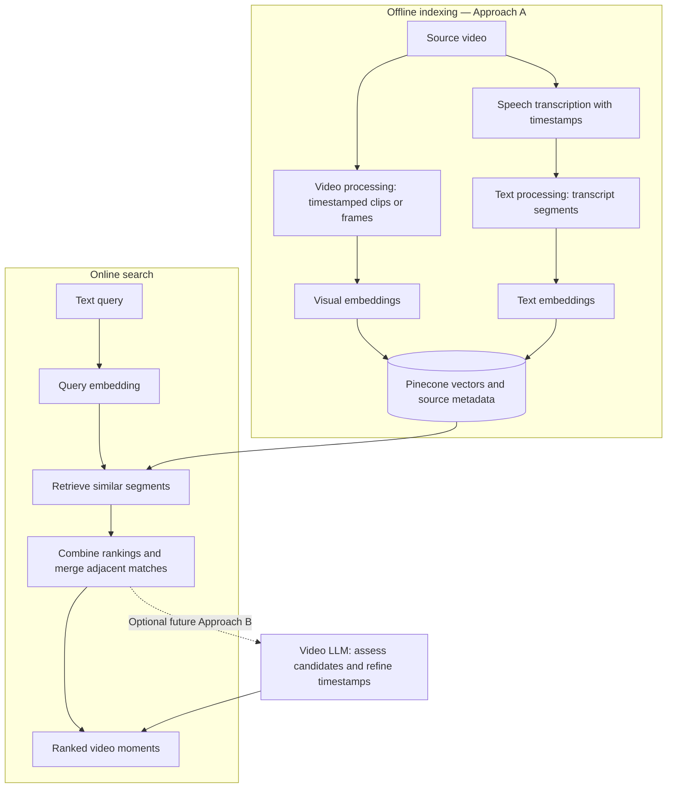

# Video Moment Retrieval

An experimental system for finding specific moments in a video library using natural-language queries. A user could search for “where the speaker explains the loss function” or “the dog jumps into the pool” and jump to the matching time range.

The intended input is a text query, optionally scoped to a video or collection. The intended output is a ranked list of moments with `video_id`, `start`, `end`, a thumbnail, and a transcript snippet when available.

## Approaches to explore

### Approach A: multimodal embedding retrieval

Split videos into timestamped segments, embed their visual content and transcripts, and store the vectors with their source metadata. At search time, embed the text query and retrieve similar segments from the vector database.

Two tracks capture different kinds of information:

- **Visual track:** embed video clips or sampled frames to find events that are visible, even when nobody describes them aloud.
- **Transcript track:** transcribe speech with timestamps, prepare the text for embedding, and retain its connection to the original video time ranges.

An optional caption track could embed descriptions generated from the visuals. Results from multiple tracks could be combined using Reciprocal Rank Fusion, with adjacent matches merged into a single moment.

The current embedding experiments use `google/embeddinggemma-2` through Sentence Transformers, with Pinecone for vector storage. This approach can reuse embeddings across searches and establish a baseline without additional training. Its limitations include segment-level timestamp precision and queries involving temporal relationships such as “after X” or “the second time.”

### Approach B: adapter + video LLM

Explore a video language model that reads a query alongside video frames, timestamps, and optional transcript text, then predicts the matching start and end times.

A frozen vision encoder would produce frame features. A trained adapter or projector would map those features into the language model’s input space. The language model could remain frozen or be adapted with LoRA, using video–caption and query–moment examples for training.

This approach is intended to explore more complex temporal queries and finer moment boundaries. It requires additional training and evaluation, has a limited video context, and may produce inaccurate timestamps. It has not been implemented in this repository.

## High-level architecture

The proposed system separates processing performed once per video from work performed for each search. The diagram describes the target architecture; the complete flow is not implemented yet.



Approach A can return results on its own. A possible combined design would pass its shortlisted clips, transcripts, and query to Approach B to assess matches and refine their boundaries.

## Current progress

The current focus is **Approach A**. Video processing is largely complete at the experimental workflow level, and attention is moving to **text processing before embedding**.

The main working entry point is [`notebooks/MM_embedding.ipynb`](notebooks/MM_embedding.ipynb). It contains experiments for loading MSR-VTT metadata, downloading source videos, splitting media into roughly 30-second clips with FFmpeg, transcribing with Whisper, generating visual embeddings, and uploading vectors with timestamps to Pinecone.

The notebook is still exploratory: saved outputs reflect different runs, and the retrieval cells reference an earlier in-memory embedding matrix rather than the Pinecone upload flow. The modules under `src/` are being extracted from these experiments; the video processor still has syntax and implementation issues. A complete retrieval application and evaluation results are not available yet.

## Plan

### Next focus: text processing for Approach A

The text scope covers **transcribed speech** and **PDF documents / lecture slides**. The next step is to compare extraction and chunking methods before embedding. The options below are candidates for investigation, not implemented features or final tool choices.

Both paths should produce text chunks with enough source information to open the original material. Speech chunks need video timestamps; document chunks need page or slide references. A PDF or slide deck does not inherently have video timestamps: connecting it to a recorded lecture requires an explicit mapping.

### 1. Transcribed speech

| Method | How it could be used | Tradeoffs and reference |
| --- | --- | --- |
| Whisper transcription with segment / word timestamps | Start with the existing Whisper workflow, retaining segment text and using `word_timestamps=True` when finer boundaries are needed. | Smallest change to the current experiment. Recognition and timing errors still need inspection, especially for technical terms and silence. See [Whisper usage](https://github.com/openai/whisper) and the [transcription options](https://github.com/openai/whisper/blob/main/whisper/transcribe.py). |
| faster-whisper with voice activity detection (VAD) | Compare an alternative Whisper implementation that supports word timestamps, batching, and filtering non-speech regions. | Useful for a throughput comparison; benchmark on our hardware. Its documented GPU path uses NVIDIA CUDA, so do not assume it uses Apple MPS. FFmpeg libraries are bundled through PyAV, although this project's video processing still needs system FFmpeg. See [faster-whisper](https://github.com/SYSTRAN/faster-whisper). |
| Forced alignment with WhisperX | Align recognized words against the audio to refine timestamps. Optional diarization can add speaker labels for multi-speaker recordings. | Adds alignment models and language-specific constraints; diarization has additional setup and model access requirements. Alignment improves placement of recognized words, not the correctness of the transcript. See [WhisperX setup and limitations](https://github.com/m-bain/whisperX) and the [WhisperX paper](https://arxiv.org/abs/2303.00747). |

**Text preparation and chunking to compare:**

- **Fixed time windows:** use the existing roughly 30-second video segments as a simple baseline. They make visual / transcript association easy, but can split sentences and explanations.
- **Sentence and pause boundaries:** group complete sentences or speech units into bounded windows, with a small overlap for context. Derive each chunk's start and end from its first and last included words. Sentence detection depends on transcription punctuation, so inspect boundaries rather than assuming they are correct.
- **Topic / semantic boundaries:** split when the subject changes, subject to a maximum token budget. This may preserve longer explanations, but adds model work and tuning. It is an optional later comparison because semantic splitting itself uses embeddings; see [LlamaIndex's semantic chunker](https://developers.llamaindex.ai/python/examples/node_parsers/semantic_chunking/).

Keep the raw transcript alongside the cleaned version. Normalize whitespace and obvious formatting noise conservatively; retain negation, numbers, equations spoken aloud, and technical vocabulary. Avoid stemming or blanket stop-word removal as the default for semantic embeddings. If transcription operates on clips, add each clip's actual start offset to its local timestamps to recover original-video times. VAD or overlap must not discard the mapping to the original timeline.

Suggested output fields: `source_id`, `video_id`, `chunk_id`, `source_type="transcript"`, `text`, `start`, `end`, `language`, and optional `speaker`. Preserve word timing and transcription settings in the saved extraction artifact so chunking can be changed without transcribing again.

### 2. PDF documents and lecture slides

Choose extraction based on the source: selectable text, scanned pages, and native PowerPoint files need different handling. A lecture deck exported as PDF follows the PDF path; a `.pptx` file can be read directly.

| Method | Best fit and proposed use | Tradeoffs and reference |
| --- | --- | --- |
| Direct PDF text extraction | Start with PyMuPDF for PDFs containing selectable text. Extract page text and, where useful, blocks with coordinates. | Lightweight baseline; text storage order may differ from reading order, especially in columns and slides. Images and diagrams need separate handling. See [PyMuPDF text extraction](https://pymupdf.readthedocs.io/en/latest/recipes-text.html). |
| Layout-aware PDF conversion | Compare PyMuPDF4LLM or Docling for headings, lists, tables, and structured Markdown / JSON. | More structure can improve chunk boundaries, but complex layouts and formulas still need inspection. Docling also supports PPTX. See [PyMuPDF4LLM](https://pymupdf.readthedocs.io/en/latest/pymupdf4llm/), [Docling formats](https://docling-project.github.io/docling/usage/supported_formats/), and [Docling chunking](https://docling-project.github.io/docling/concepts/chunking/). |
| OCR for scanned pages or image-only text | Use Tesseract through PyMuPDF's OCR integration when usable embedded text is absent. Cache OCR results per page. | Slower than native extraction; language data and scan quality matter. Math, handwriting, and chart meaning may be poorly recovered. Avoid OCR on clean selectable text by default. See [PyMuPDF OCR](https://pymupdf.readthedocs.io/en/latest/recipes-ocr.html). |
| Native PPTX extraction | Use python-pptx to extract text from slide shapes and tables; consider speaker notes as a separate field. | Retains slide identity without PDF conversion. Shape order is not guaranteed reading order; grouped objects, charts, and text inside images need extra handling. It does not render slides. See [python-pptx text extraction](https://python-pptx.readthedocs.io/en/latest/user/quickstart.html). |
| Visual interpretation as an optional supplement | Retain page / slide images and consider generated descriptions for diagrams that text extraction misses. | Treat descriptions as derived content with links to the image, since they may misread diagrams or invent details. This extends the optional caption track described in Approach A; it should not replace the original extracted text. |

**Text preparation and chunking to compare:**

- **Page / slide baseline:** one chunk per short page or slide, including its title. Split dense pages by paragraphs or bullet groups; retain the page or slide number on every resulting chunk.
- **Structure-aware chunks:** group content by section headings, paragraphs, lists, or tables, and include the heading context in the embedding text. Preserve table headers when splitting tables. [Docling's HybridChunker](https://docling-project.github.io/docling/concepts/chunking/) combines document structure with tokenizer-based size limits.
- **Token-bounded fallback:** split oversized text at paragraph, then sentence boundaries, with limited overlap. Use the selected embedding model's tokenizer and input limit, allowing room for titles and prefixes. Character counts alone do not establish whether a chunk fits.

Remove repeated headers / footers and repair line wrapping or hyphenation only when safe. Keep titles, bullet hierarchy, mathematical notation, and table relationships. Save the original extracted content and page images for inspection; do not silently summarize away details before embedding.

Suggested output fields: `source_id`, `chunk_id`, `source_type` (`pdf` or `slides`), `text`, `file_path`, `page_numbers` or `slide_numbers`, `section_title`, `extraction_method`, and optional bounding boxes / image references. Add a shared `lecture_id` when the material belongs to a recording; populate video time ranges only when a verified mapping exists.

### 3. Initial comparison and decisions

Start by comparing timestamped Whisper sentence windows for speech, direct extraction for text PDFs / native PPTX, and OCR only where needed. Compare layout-aware conversion on documents where the baseline loses reading order or structure. This is a proposed starting point, pending experiments.

Inspect representative samples for missing words, technical terms, timestamp offsets, reading order, bullet structure, tables, formulas, and source references. Then compare chunk sizes and overlaps using the same search queries, recording retrieval quality and processing cost. Keep extraction separate from chunking so that changing chunk boundaries does not require repeating transcription or OCR.

Decisions still to make: transcription engine and model, whether alignment / speaker labels are needed, document parser, OCR languages, chunk sizes and overlap, and how slides / PDFs relate to video moments. Standalone document search results should open the matching page or slide; they should not be presented as video moments without a time mapping.

### 4. Optional setup for these experiments

The commands below document dependencies for the chosen method; they have not been run. Install only the tools needed for the experiment. The existing `brew install ffmpeg deno yt-dlp` setup remains relevant to media processing and downloading.

| Tool | When needed | macOS command / reference |
| --- | --- | --- |
| Tesseract | Required when choosing the Tesseract OCR path. Homebrew includes English and orientation data. | `brew install tesseract` — [formula](https://formulae.brew.sh/formula/tesseract). |
| Additional OCR languages | Optional for non-English OCR, such as Japanese. Configure the OCR language explicitly, e.g. `eng+jpn`. | `brew install tesseract-lang` — [language data](https://formulae.brew.sh/formula/tesseract-lang). |
| Poppler | Optional CLI tools such as `pdftotext` and `pdftoppm` for extraction comparisons or rendering. Not required by PyMuPDF. | `brew install poppler` — [formula](https://formulae.brew.sh/formula/poppler). |
| LibreOffice | Optional for converting presentations to PDF for a common extraction / rendering path. Not required for direct PPTX extraction. | `brew install --cask libreoffice` — [cask](https://formulae.brew.sh/cask/libreoffice). |

Candidate Python installs, in the project environment:

```bash
# Direct PDF and native PPTX extraction
python -m pip install pymupdf python-pptx

# Optional layout-aware parsers; compare independently
python -m pip install pymupdf4llm
python -m pip install docling

# Optional alternative speech transcription engine
python -m pip install faster-whisper
```

Whisper is already listed in `requirements.txt`. For WhisperX, follow its linked installation guide and use a separate environment if its PyTorch / alignment dependencies conflict with the current notebook environment. No new packages have been added to the project requirements yet.

## Repository contents

| Path | Purpose |
| --- | --- |
| `notebooks/MM_embedding.ipynb` | Main notebook for processing, embedding, storage, and retrieval experiments. |
| `src/config/file_config.py` | Data directory setup and importing videos from URLs, ZIP files, or local directories. |
| `src/processors/video_processor.py` | In-progress extraction of video segmentation and metadata handling into a module. |
| `src/processors/embedding.py` | Embedding model wrapper with device selection and text, video, and image methods. |
| `data/` | Local source media, queue, history, and segment metadata directories. |
| `notebooks/note_assets/` | Notebook-local input media, queued clips and CSV metadata, and history directories. |
| `requirements.txt` | Python dependencies used by the project. |

Virtual environments, local media, and generated notebook assets are excluded from Git.

## Local setup

The project uses Python, Jupyter, FFmpeg, Whisper, PyTorch, Sentence Transformers, and Pinecone. On macOS, install the media tools used by the experiments:

```bash
brew install ffmpeg deno yt-dlp
```

FFmpeg handles media segmentation, `yt-dlp` downloads source videos, and Deno provides a JavaScript runtime for download workflows that need one.

Create a Python environment and install the dependencies:

```bash
python3 -m venv .venv
source .venv/bin/activate
python -m pip install --upgrade pip
python -m pip install -r requirements.txt
python -m pip install jupyter torch datasets yt-dlp
```

The requirements are not pinned, and the notebook remains an experimental workflow. Model initialization may download weights. Pinecone cells read `PINECONE_API_KEY` from the environment; configure it locally before using those cells.

The notebook uses paths relative to its working directory. Start Jupyter from `notebooks/`:

```bash
cd notebooks
jupyter notebook MM_embedding.ipynb
```

Review cells before running them: the notebook includes a cleanup cell that removes its asset directory and an embedding loop that deletes each processed clip before uploading its vector. Saved cell outputs do not establish that a fresh sequential run will succeed.

## References

| Resource | What it is useful for |
| --- | --- |
| [Pinecone: bring your own vectors](https://docs.pinecone.io/guides/get-started/quickstart/bring-your-own-vectors) | Reference for storing embeddings generated by our own model and retrieving similar vectors. |
| [EmbeddingGemma 2 model card](https://huggingface.co/google/embeddinggemma-2) | Model information and usage guidance for the embedding model selected for the experiments. |
| [EmbeddingGemma 2 serving guide — SGLang](https://docs.sglang.io/cookbook/autoregressive/Google/EmbeddingGemma2.md) | Reference for exploring model serving beyond the current notebook workflow. |
| [Sentence Transformers documentation](https://www.sbert.net/) | Reference for the embedding interface used by the notebook and Python wrapper. |
| [OpenAI Whisper](https://github.com/openai/whisper) | Speech transcription setup and usage, supporting the transcript track. |
| [MSR-VTT dataset used by the notebook](https://huggingface.co/datasets/VLM2Vec/MSR-VTT) | Source of video metadata and captions used in the current experiments. |
| [FFmpeg documentation](https://ffmpeg.org/documentation.html) | Reference for video segmentation and timestamp handling. |
| [yt-dlp](https://github.com/yt-dlp/yt-dlp) | Reference for downloading source videos and configuring download dependencies. |
